<picture>
  <source media="(prefers-color-scheme: dark)" srcset="assets/banner-dark.svg" />
  
</picture>

**Senior Frontend Engineer & Designer** with 10+ years in web, focused since 2023 on **AI-powered products, local LLMs and agent-based systems**. Former Scrum Master and team lead (2016–2022). Based in Darmstadt, Germany.

Not "I read a blog post about RAG", but "I run embeddings locally, ship agents to production, and can tell you where they fall apart."

### Now

- Building local-first agent tooling: MCP servers, multi-model pipelines, context engineering
- Running the whole stack on my own hardware with Ollama — no cloud required
- Turning job hunting into an LLM pipeline with **Jobschleuse**

### Selected work

**[Synapse](https://github.com/darkjive/Synapse)** 
Brain-inspired, local-first knowledge graph: notes as a graph with activation, trust and temporal decay. 
Python · FastAPI · React · Three.js · Ollama

**[Jobschleuse](https://github.com/darkjive/Jobschleuse)** 
From job listing to finished application: a local LLM pipeline instead of SaaS. 
Python · FastAPI · React · uv

**[opencode-mcp-vision](https://github.com/darkjive/opencode-mcp-vision)** 
Local MCP server for image analysis via an Ollama vision model, cloud-free. 
Python · MCP · Ollama

**[Zeitgeber](https://github.com/darkjive/Zeitgeber)** · [live](https://zeitgeber-app.vercel.app) 
Astronomically correct sun clock showing the gap between social and solar time. Offline PWA, no tracking. 
TypeScript · PWA

**[Leitstand](https://github.com/darkjive/Leitstand)** 
Single pane of glass for my self-hosted homelab. 
TypeScript · React · Vite

Also: client work at [wohlfühlgesundheit.de](https://wohlfühlgesundheit.de) and my portfolio [pxlngn-net.vercel.app](https://pxlngn-net.vercel.app) (Astro, Lighthouse 100).

### Stack

TypeScript · React · Astro · Tailwind · Node.js · Python · FastAPI · Ollama · MCP · Docker · Linux

### Activity

<picture>
  <source media="(prefers-color-scheme: dark)" srcset="https://raw.githubusercontent.com/darkjive/darkjive/output/snake-dark.svg" />
  
</picture>

### Connect

[Website](https://pxlngn-net.vercel.app) · [LinkedIn](https://www.linkedin.com/in/alain-ritter-b49ba8233/) · [X](https://x.com/pxlngn)
